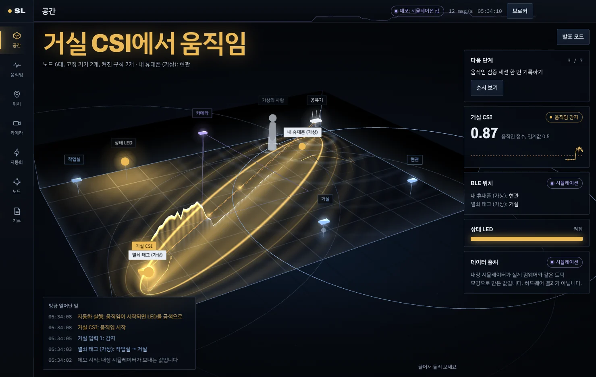
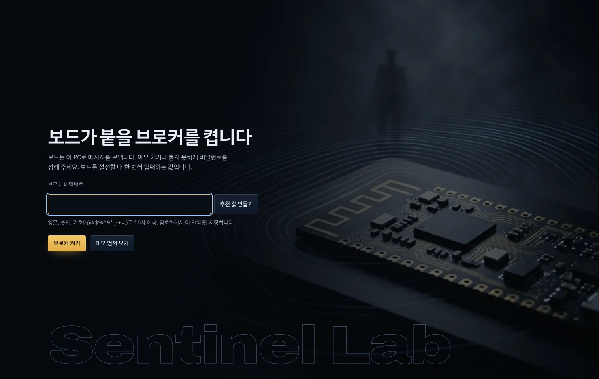
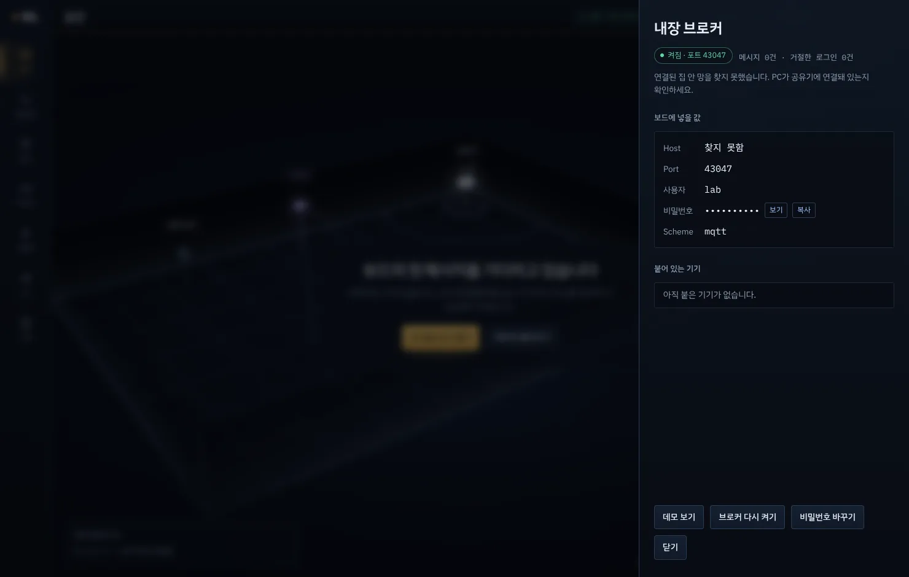
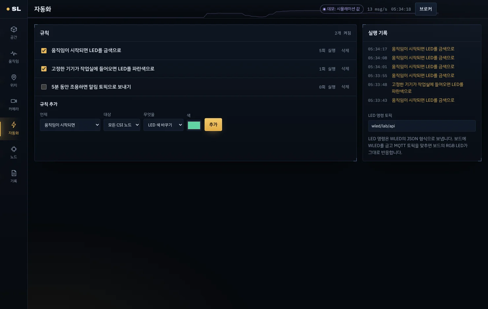
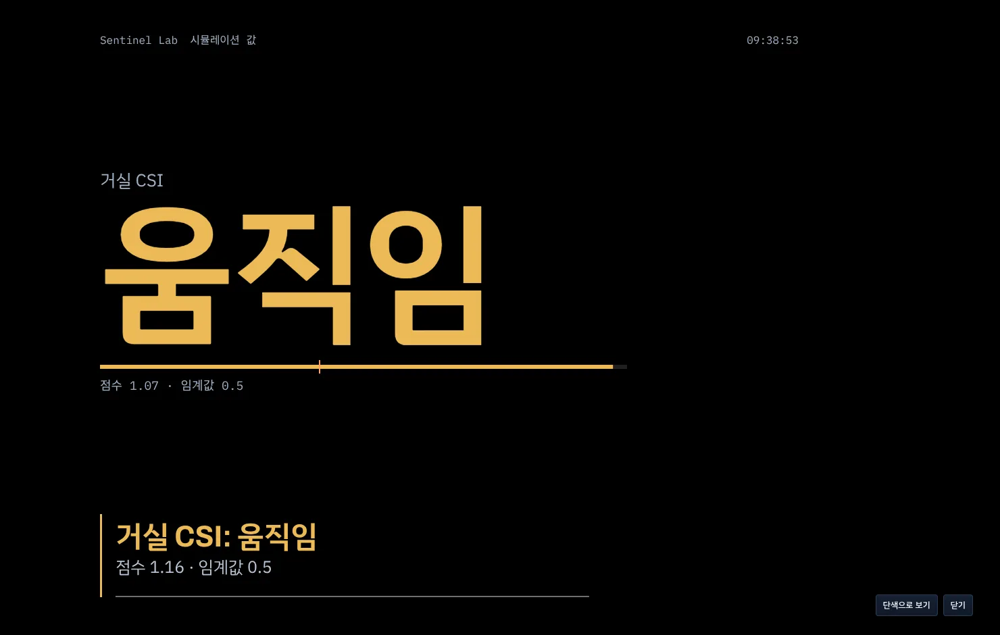

# Sentinel Lab

English: [README.md](README.md)

오픈소스 ESP32 감지 펌웨어를 보드별로 올려 놓고 한 화면에서 시험하는 데스크톱 앱입니다.
앱이 보드용 MQTT 허브를 직접 띄우고, 보드가 보낸 값을 한 콘솔에 모으고, 감지 결과를 정답과
맞춰 보며, 시뮬레이션 값과 실측을 엄격히 구분합니다.



이 문서의 화면에 보이는 값은 모두 내장 시뮬레이터가 만든 것입니다. 이 저장소는 아직 어떤
하드웨어 결과도 주장하지 않습니다. [지금 상태](#지금-상태)를 보세요.

## 무엇을 하나

- **앱 하나로 끝.** 앱을 켜면 MQTT 허브가 함께 켜집니다. Docker도 스크립트도 필요 없습니다. 첫 실행 화면에서 허브 비밀번호 하나만 정하면, 보드에 넣을 값을 보여 줍니다.
- **보드 한 대에 펌웨어 하나, 원본 그대로.** ESPectre는 Wi‑Fi 채널 상태 정보로 움직임을, ESPresense는 방마다 블루투스 거리를, Tasmota는 ESP32‑CAM 영상을 맡습니다. 각자의 웹 설치 페이지에서 굽고 MQTT로 보고합니다.
- **원리를 보여 주는 화면.** 3D 공간은 Wi‑Fi 링크의 감지 구역(프레넬 영역)을 바닥에 그리고, 최근 14초의 움직임 점수를 링크 위에 막으로 세웁니다. 임계값을 넘은 부분은 금색이 됩니다.
- **느낌이 아니라 검증.** 세션은 사람이 실제로 링크를 지나간 시간을 기록해 펌웨어의 감지와 맞춰 봅니다. 감지, 놓침, 오탐, 재현율이 나옵니다. 정답은 키를 누르거나, PIR 센서로, 데모에서는 시뮬레이터로 기록합니다.
- **넘겨줄 수 있는 증거.** 메시지 기록을 내려받고, 나중에 재생하고, 세션별 점수 곡선이 든 HTML 리포트를 만듭니다.
- **안경·휴대폰 알림.** 규칙과 검증 세션이 짧은 문장을 토픽 하나로 내보냅니다. 이 토픽에는 앱만 쓸 수 있어서, 받는 쪽 앱은 MQTT 구독만 하면 됩니다. 검은 바탕의 전체 화면에서 안경에 뜰 모습을 미리 봅니다. 실제 안경에서는 아직 확인하지 않았습니다. 형식: [docs/NOTIFY.md](docs/NOTIFY.md).

| 첫 실행 | 허브 정보 |
|---|---|
|  |  |

| 규칙과 알림 미리보기 | 안경 화면 |
|---|---|
|  |  |

## 실행

```powershell
npm ci
npm start
```

Node.js 22가 필요합니다. 첫 실행에서 허브 비밀번호를 정한 뒤 "노드" 화면의 순서를 따라갑니다.
시뮬레이터로 콘솔만 보려면 `console/index.html`을 Chrome이나 Edge로 엽니다.
데스크톱 앱 없이 쓰는 Docker용 Mosquitto 구성은 `broker/`에 있습니다.

## 데모와 개인정보 처리방침 페이지

저장소가 공개되면 `pages` 워크플로가 시뮬레이터 데모와 개인정보 처리방침을 GitHub Pages에 올립니다.
주소는 `https://pengveloper.github.io/airfab-sentinel/` 과 `/privacy/` 이고, 아직 실행된 적은 없습니다.

## 실측 순서

앱의 "노드" 화면에 같은 순서가 있고, 보드의 메시지를 받으면 단계가 자동으로 채워집니다.

1. **허브 켜기.** 앱을 켜고 비밀번호를 정합니다. "브로커" 창에 보드에 넣을 Host, Port, 사용자가 나옵니다.
2. **보드 ① ESPectre.** https://espectre.dev/tools/flash/ 에서 굽고 와이파이를 넣은 뒤, Device settings의 MQTT에 위 값을 넣습니다. Scheme은 `mqtt`입니다.
3. **검증 세션.** "움직임" 화면에서 세션을 시작하고, 보드와 공유기 사이를 지나가는 동안 L 키를 누릅니다.
4. **보드 ②③과 C3 ESPresense.** https://espresense.com/firmware 에서 굽습니다. 보드가 `espresense-`로 시작하는 와이파이를 띄우면 접속해 방 이름(office, living, entry)과 MQTT 값을 넣습니다.
5. **배치 맞추기.** "위치" 화면에서 방 크기를 넣고 노드를 실제 자리로 끌어다 놓습니다.
6. **ESP32‑CAM.** https://tasmota.github.io/install/ 에서 tasmota32-webcam을 골라 굽고, "카메라" 화면에 `http://카메라주소:81/stream`을 넣습니다.
7. **기록.** "기록" 화면에서 JSONL을 내려받고 리포트를 만듭니다.

보드는 2.4GHz 와이파이에만 붙습니다. 보드가 허브에 붙지 않으면 Windows가 처음 띄운 방화벽
창에서 개인 네트워크를 허용했는지 확인하세요. 앱은 방화벽 설정을 바꾸지 않습니다.

### PIR 정답 센서 (HC‑SR501)

ESPresense 보드 한 대에 연결합니다. USB를 뽑은 상태에서 배선합니다.

| PIR 핀 | 보드 핀 |
|---|---|
| VCC | 5V |
| GND | GND |
| OUT | 비어 있는 GPIO 하나 |

ESPresense 웹 화면의 Hardware에서 Inputs에 Role을 Motion으로 추가하면
`espresense/rooms/{room}/input_1`에 `ON`/`OFF`가 옵니다. "움직임" 화면의 정답 출처에서
"PIR 입력"을 고릅니다.

## 보안

앱이 집 안 망에서 포트를 열기 때문에 방어적으로 만들었습니다.

- **창 격리.** 창은 샌드박스 안에서 앱에 들어 있는 파일만 불러오고, 검증된 호출 11개로만 시스템에 닿습니다. 다른 주소로 이동하거나 새 창을 열 수 없습니다.
- **허브 보호.** 비밀번호가 있어야 붙고, 사설망 주소만 받으며, 로그인 실패 횟수와 연결 수, 메시지 크기를 제한합니다.
- **비밀 저장.** 허브 비밀번호는 Windows 자격 증명 보호(DPAPI)로 암호화해 저장합니다.
- **빌드.** 실행 파일은 Electron fuse로 잠그고, CI가 의존성 감사와 Microsoft Defender 검사를 돌립니다.

무엇을 막지 못하는지까지 [SECURITY.md](SECURITY.md)에 적었습니다. 집 안 망의 MQTT는 암호화되지 않습니다.

## Windows 경고 없이 설치하기

Windows는 코드 내용이 아니라 서명과 평판으로 경고 여부를 정합니다. 그래서 이것은 설계만으로
해결되지 않고 배포 경로의 문제입니다.

- **경고가 없는 경로는 Microsoft Store입니다.** Microsoft가 패키지에 직접 서명하고, 개인 개발자 등록은 무료입니다. Store용 패키지는 지금 CI에서 빌드되고, 제출은 아직입니다.
- **CI가 만드는 zip은 서명이 없어서** 처음 실행할 때 Windows가 경고합니다. 체크섬으로 확인할 수 있는 개발자용입니다.

경로별 비교, Store 제출 순서, 백신 관련 조치는 [docs/DISTRIBUTION.md](docs/DISTRIBUTION.md)에 있습니다.

## 지금 상태

| 항목 | 상태 |
|---|---|
| 콘솔 화면, PIR 정답 입력, 기록 재생, 리포트, 발표 모드, 알림 미리보기, 안경 화면 | 내장 시뮬레이터로 확인 (SIMULATED) |
| 데이터 계층 (가림, 감지 구간, 세션 통계, 위치 추정, 보관 메시지, 규칙) | 자동 시험 16건 통과 (SOFTWARE_VERIFIED) |
| 내장 허브 (사설망만 수락, 인증, 로그인 제한, 예약 토픽과 앱 전용 토픽, 크기 제한) | 실제 소켓으로 자동 시험 10건 통과 (SOFTWARE_VERIFIED) |
| 데스크톱 앱 (창 격리, 첫 실행, 비밀번호 저장, 메시지 흐름, 규칙 전달, 알림 전달, 이동 차단) | Linux에서 실제 앱 연기 시험 통과, 묶은 빌드 기동 확인 (SOFTWARE_VERIFIED) |
| Windows 빌드, DPAPI, MSIX 패키징, Defender 검사 | GitHub Actions `windows-latest`에서 통과 (EVD-P1-011). 최신 실행 결과 참고 |
| 실제 안경이나 휴대폰 앱에 알림 표시 | 아직 안 함 (OPERATOR_REQUIRED) |
| Microsoft Store로 경고 없이 설치 | 아직 안 함 (OPERATOR_REQUIRED) |
| 실제 보드 | 아직 측정 안 함 (OPERATOR_REQUIRED) |

요구사항, 시험, 증거의 연결은 [docs/TRACEABILITY.md](docs/TRACEABILITY.md), 증거표는
[evidence/EVIDENCE-P1.md](evidence/EVIDENCE-P1.md)에 있습니다.

## 시험

```powershell
npm test            # 데이터 계층 (T-CON-001~016), 허브 (T-HUB-001~010)
npm run test:app    # 실제 앱을 띄워 격리, 첫 실행, 인증, 메시지 흐름 확인
```

## 지키는 것

- 허브 비밀번호, Wi‑Fi 정보, 가리지 않은 MAC이 든 캡처는 저장소에 올리지 않습니다.
- 화면과 내보낸 기록에서 기기 식별자는 앞 4자만 남깁니다.
- 시뮬레이터 값이 섞인 기록은 SIMULATED로 표시되며 하드웨어 결과로 쓰지 않습니다.
- 허브가 보관(retained)하고 있던 예전 메시지는 첫 실측 순서의 확인으로 세지 않습니다.
- 콘솔의 "확인" 표시는 메시지를 받았다는 뜻입니다. HARDWARE_VERIFIED 판정은 `evidence/` 양식에 사람이 적습니다.
- 콘솔 안의 배너 사진 두 장은 연출용 이미지이며 실제 실험 장비 사진이 아닙니다.
- 네트워크를 공격하거나 방해하는 도구는 다루지 않습니다.

## 폴더

- `desktop/` Electron 메인 프로세스, 내장 허브, preload, 패키징 설정
- `console/` 콘솔 (데스크톱 창 안에서도, 정적 페이지로도 동작)
- `tests/` 데이터 계층, 허브, 앱 연기 시험, 묶은 빌드 확인
- `broker/` 데스크톱 앱 없이 쓰는 Mosquitto 구성
- `tools/` 실제 브로커로 시뮬레이션 메시지를 보내는 도구
- `evidence/`, `docs/` 증거표, 스크린샷, 추적표, 배포 문서

## 라이선스

[MIT](LICENSE). 포함한 라이브러리와 연동하는 펌웨어는 [THIRD_PARTY_NOTICES.md](THIRD_PARTY_NOTICES.md), 개인정보는 [PRIVACY.md](PRIVACY.md)에 있습니다.
