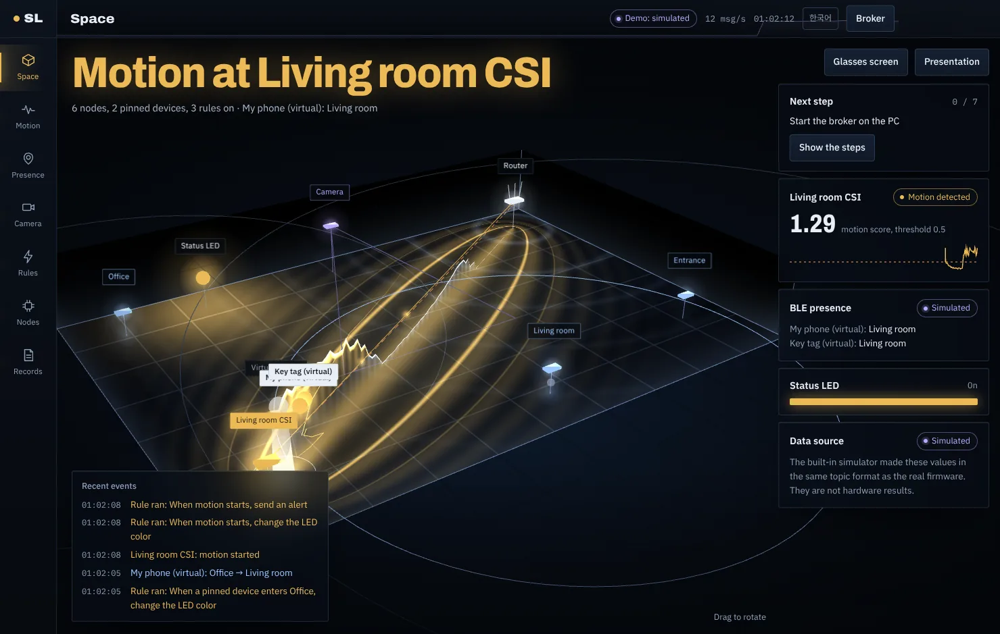
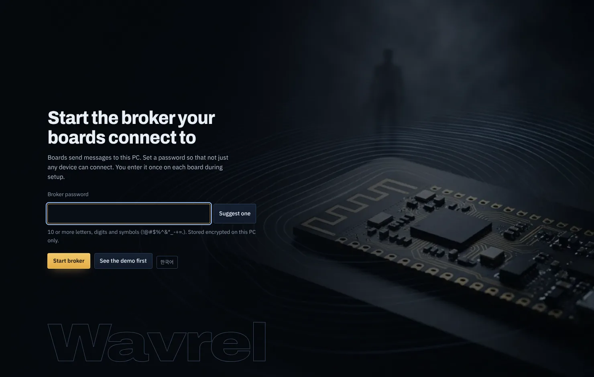
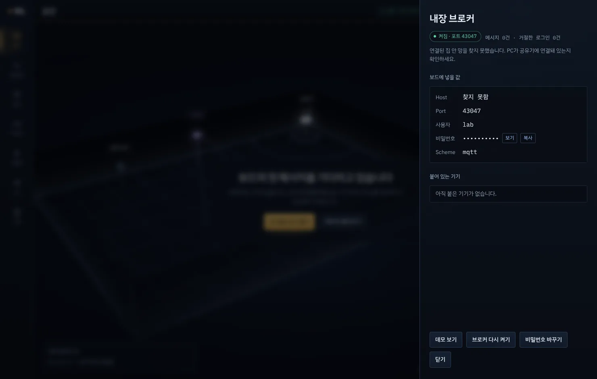
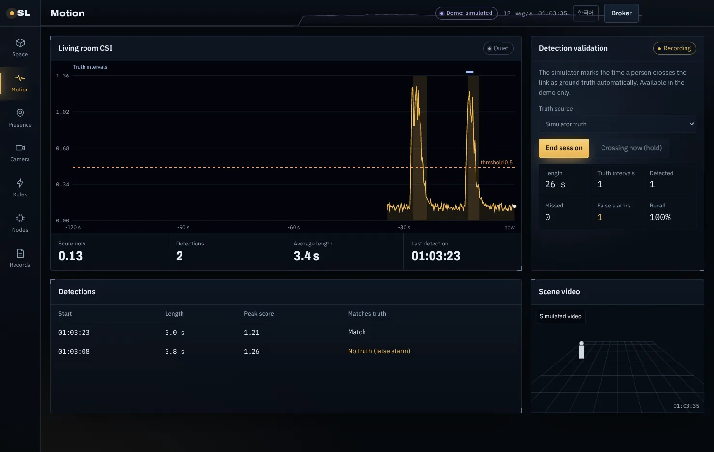
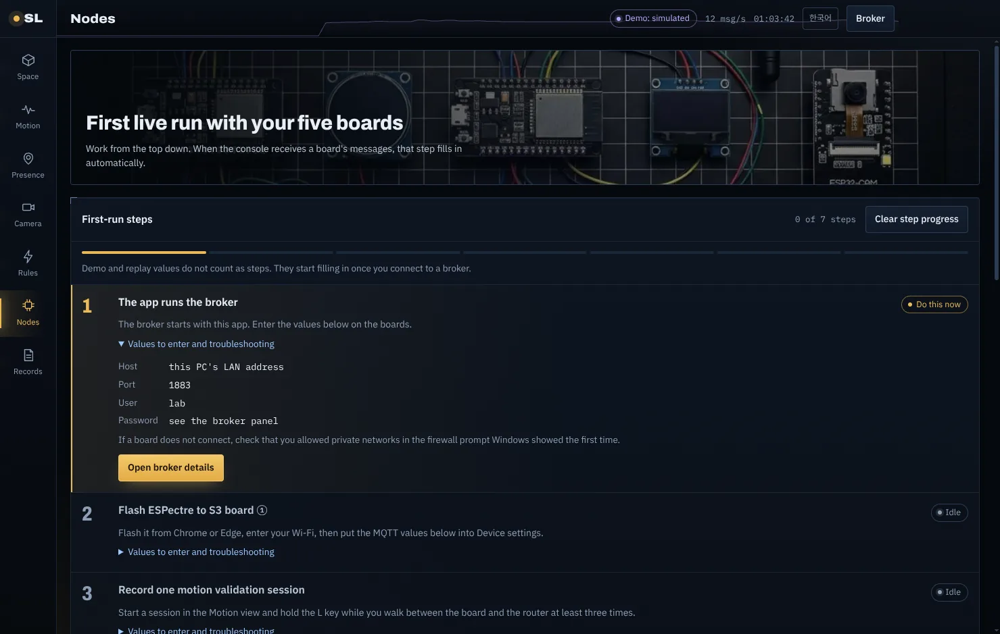
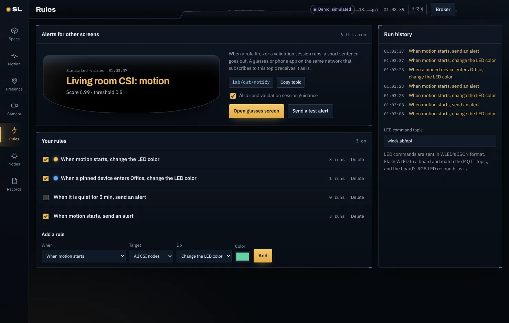
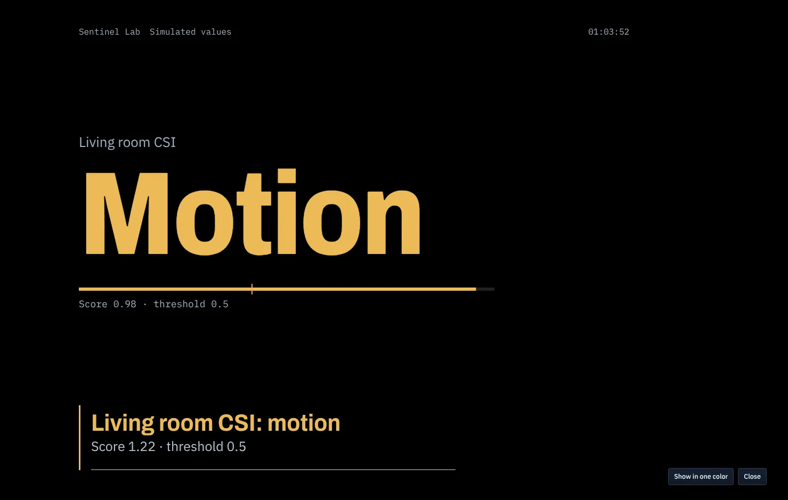
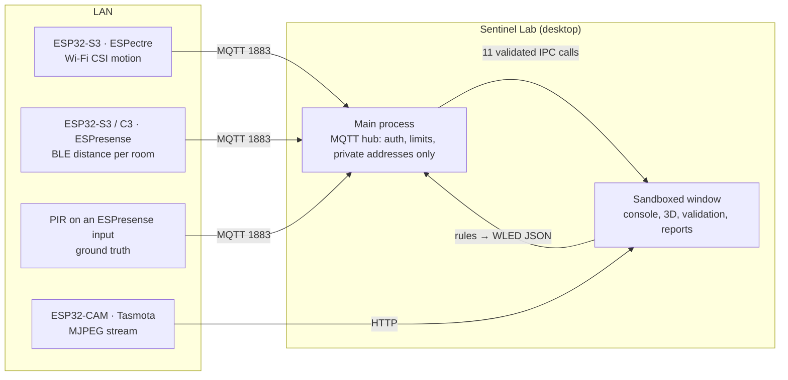

# Sentinel Lab

A desktop app for trying open-source ESP32 sensing firmware side by side. It runs an MQTT
hub for your boards, shows what they report in one console, checks detections against
ground truth, and keeps simulated data and real measurements strictly apart.

한국어 문서: [README.ko.md](README.ko.md)



Every value in these screenshots comes from the built-in simulator. No hardware result is
claimed in this repository yet. See [Status](#status).

## What it does

- **One app instead of a toolchain.** Start the app and the MQTT hub starts with it. No Docker, no scripts. The first-run screen asks for one thing, the hub password, and then shows the values to type into each board.
- **One firmware per board, unmodified.** ESPectre senses motion from Wi-Fi channel state information, ESPresense measures Bluetooth distance per room, Tasmota streams an ESP32-CAM. Each is flashed from its own web installer and reports over MQTT.
- **A console that explains the physics.** The 3D view draws the sensing region of each Wi-Fi link (its Fresnel zones) on the floor and raises the last 14 seconds of motion score as a ribbon along the link. The part above the detection threshold turns gold.
- **Validation, not vibes.** A session records when a person really crossed the link and matches that against the firmware's detections: hits, misses, false detections, recall. Ground truth comes from a held key, a PIR sensor, or (demo only) the simulator.
- **Evidence you can hand over.** Export the message log, replay it later, and generate a standalone HTML report with the score curve of every session.
- **English and Korean.** The interface follows the system language and switches with one button. A test fails the build if any sentence lacks a translation.
- **Alerts for glasses and phones.** Rules and validation sessions publish one short sentence at a time on a single topic that only the app can write to, so a wearable app needs nothing but an MQTT subscription. A full-screen black page previews what the glasses would show. No receiver has been tested on real glasses yet. Format: [docs/NOTIFY.md](docs/NOTIFY.md).

| First run | Hub panel |
|---|---|
|  |  |

| Motion and validation | First-measurement guide |
|---|---|
|  |  |

| Rules and alert preview | Glasses screen |
|---|---|
|  |  |

## Architecture



The same console code also runs as a static web page with the simulator, which is how a
public demo can be hosted without any server. One ESP32 has a single 2.4 GHz radio and
these firmwares carry their own licenses, so the project integrates them at the message
level instead of merging them into one binary.

A site hub that boards can reach on the LAN is also the unit that scales: more sites means
more hubs, and a cloud relay (for example to AWS IoT Core) can be added per hub when a
central view is needed. That relay is on the roadmap, not in this version.

## Security

The app listens on your LAN, so it is built defensively. The window is sandboxed, loads
only files shipped with the app, and reaches the system through eleven validated calls.
The hub requires a password, accepts only private-range addresses, limits failed logins,
connection count and message size, and stores the password with Windows credential
protection. The executable is hardened with Electron fuses, and CI audits dependencies and
scans every build with Microsoft Defender.

Details, test references and the list of what is not covered: [SECURITY.md](SECURITY.md).

## Installing without Windows warnings

Windows decides whether to warn by signature and reputation, so this is a distribution
question rather than a code question. The warning-free path is the Microsoft Store, which
signs the package itself and is free for individual developers. The Store package builds in
CI today; submission is pending. Until then, the portable zip from CI is unsigned and
Windows will warn on first run.

The full comparison of channels, the Store steps and the antivirus notes are in
[docs/DISTRIBUTION.md](docs/DISTRIBUTION.md).

## Demo and privacy page

The `pages` workflow publishes the simulator demo and the privacy policy to GitHub Pages once this
repository is public: `https://pengveloper.github.io/airfab-sentinel/` and `/privacy/`. It has not run yet.

## Run it

```sh
npm ci
npm start
```

Node.js 22. On first run, set the hub password and follow the guide in the Nodes view.
To see the console alone with the simulator, open `console/index.html` in Chrome or Edge.
A Docker-based Mosquitto kit for use without the desktop app is in `broker/`.

## Hardware roles

| Board | Role | Firmware (flashed from its own web installer) |
|---|---|---|
| ESP32-S3 DevKitC-1 N16R8 | Wi-Fi CSI motion sensing | [ESPectre](https://github.com/francescopace/espectre) |
| ESP32-S3 DevKitC-1 N16R8 ×2, ESP32-C3 Super Mini | BLE presence, one per room | [ESPresense](https://github.com/ESPresense/ESPresense) |
| ESP32-CAM | Camera stream | [Tasmota](https://github.com/arendst/Tasmota) (tasmota32-webcam) |
| HC-SR501 PIR (optional) | Ground truth for validation | wired to an ESPresense input |

None of these firmwares is included or modified here. Each keeps its own license.

## Status

| Item | Status |
|---|---|
| Console views, PIR ground truth, replay, report, presentation mode, alert preview, glasses screen | Checked with the built-in simulator (SIMULATED) |
| Data layer: masking, detection intervals, session statistics, trilateration, retained-message handling, rules | 19 automated tests pass (SOFTWARE_VERIFIED) |
| Embedded hub: private addresses only, authentication, login throttling, reserved and app-only topics, size limits | 10 automated tests over real TCP sockets pass (SOFTWARE_VERIFIED) |
| Desktop app: window isolation, first run, password storage, message flow, rule delivery, alert delivery, navigation lock | Smoke test of the real app passes on Linux; packaged build starts (SOFTWARE_VERIFIED) |
| Windows build, DPAPI path, MSIX packaging, Defender scan | Passes in GitHub Actions on `windows-latest` (EVD-P1-011); see the latest run |
| English interface: every sentence translated, no Korean left on any screen or in the report | 4 automated tests and an English pass in the app smoke test (SOFTWARE_VERIFIED) |
| Alerts shown on real glasses or a phone app | Not done yet (OPERATOR_REQUIRED) |
| Installing from the Microsoft Store without a warning | Not done yet (OPERATOR_REQUIRED) |
| Real boards | Not measured yet (OPERATOR_REQUIRED) |

Requirements, tests and evidence are linked in [docs/TRACEABILITY.md](docs/TRACEABILITY.md).
The evidence table is in [evidence/EVIDENCE-P1.md](evidence/EVIDENCE-P1.md).

## Tests

```sh
npm test            # data layer (T-CON-001..019), hub (T-HUB-001..010), language (T-I18N-001..004)
npm run test:app    # starts the real app: isolation, first run, auth, message flow, alerts, English
```

On Linux the app test needs a display: `xvfb-run -a npm run test:app`.

## Repository layout

```
web/        privacy policy page published to GitHub Pages
desktop/    Electron main process, embedded hub, preload bridge, packaging config
console/    the console (runs in the desktop window and as a static page)
tests/      data layer, hub, app smoke test, packaged-build check
broker/     optional Mosquitto kit for running without the desktop app
tools/      broker-sim.html, a publisher of simulated messages through a real broker
evidence/   evidence table and the template for hardware verification
docs/       screenshots, traceability, distribution
```

## Scope

- Built for a home or lab LAN. MQTT on the LAN is not encrypted; see SECURITY.md.
- Tools for attacking or jamming networks are out of scope.
- The two banner photographs inside the console are staged illustrations, not photos of the lab equipment.

## License

[MIT](LICENSE). Third-party notices: [THIRD_PARTY_NOTICES.md](THIRD_PARTY_NOTICES.md). Privacy: [PRIVACY.md](PRIVACY.md).
