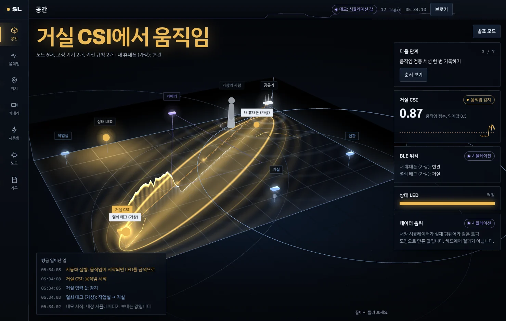
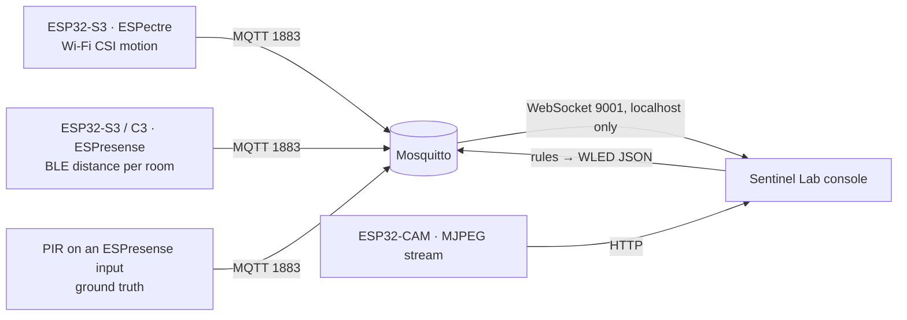
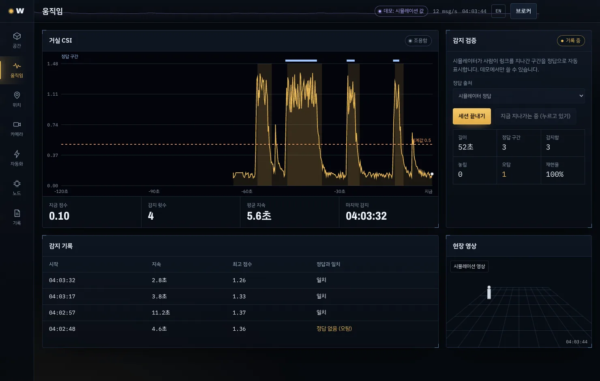
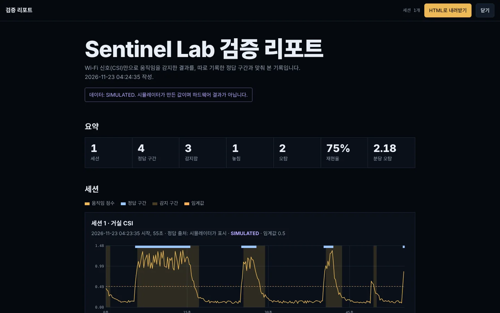
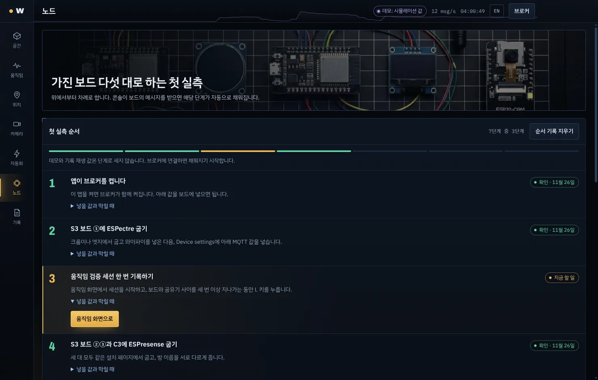

# Sentinel Lab

A browser console for trying open-source ESP32 sensing firmware side by side.
Each board runs one complete upstream firmware and reports over MQTT; this console
collects the messages into one view, checks detections against ground truth, and
keeps a strict line between simulated data and real measurements.

한국어 문서: [README.ko.md](README.ko.md)



Every value in these screenshots comes from the built-in simulator. No hardware
result is claimed anywhere in this repository yet. See [Status](#status).

## Why it is built this way

One ESP32 has a single 2.4 GHz radio, and projects such as ESPectre (Wi-Fi CSI motion
sensing) and ESPresense (BLE presence) are complete firmwares with their own licenses.
Merging them into one binary is neither practical nor clean. Sentinel Lab keeps them
separate instead:

- one firmware per board, flashed unmodified from the upstream web installers
- one MQTT broker on the LAN
- one console that understands each firmware's topics



## What the console does

| View | What you get |
|---|---|
| Space | 3D room with the CSI link, BLE nodes, tracked devices and a live event feed. Presentation mode fills the screen for recordings. |
| Motion | Score timeline with the detection threshold, plus validation sessions that compare detections with ground truth. |
| Presence | Floor plan with trilaterated BLE device positions. Drag nodes to where they really are. |
| Camera | MJPEG stream from an ESP32-CAM next to the sensor data. |
| Rules | "When motion starts, set the LED" style automations, published as WLED JSON. |
| Nodes | A seven-step first-measurement guide that fills in as real board messages arrive. |
| Evidence | Message log export (JSONL), log replay, a Markdown summary, and a standalone HTML report. |



### Validation sessions

A session records when a person actually crossed the link (ground truth) and matches
those intervals against the firmware's detections, allowing two seconds of slack on
either side. It reports hits, misses, false detections and recall. Ground truth can
come from a held button, from a PIR sensor wired to an ESPresense input, or, in demo
mode only, from the simulator.



### Honest labelling

- Simulator data is labelled SIMULATED in the UI, in exports and in reports.
- Messages received from a broker are labelled as received, not as verified. A human
  records hardware verification in `evidence/` with the board, firmware version and operator.
- Retained MQTT messages are never counted as fresh evidence, and a retained message
  alone does not create a node.
- Device identifiers are masked to their first four characters on screen and in exports.

## Quick start

Open `console/index.html` in Chrome or Edge. It starts in demo mode with the built-in
simulator. There is nothing to install or build.

To receive real messages:

```powershell
cd broker
./start.ps1        # Windows, PowerShell 7. macOS and Linux: ./start.sh
```

The script asks you to choose the broker password, starts Mosquitto in Docker, prints
the LAN address to enter on the boards, and opens the console. Then follow the guide
in the Nodes view. The password hash lives in a Docker volume, not in this folder.



## Hardware roles

| Board | Role | Firmware (flashed from its own web installer) |
|---|---|---|
| ESP32-S3 DevKitC-1 N16R8 | Wi-Fi CSI motion sensing | [ESPectre](https://github.com/francescopace/espectre) |
| ESP32-S3 DevKitC-1 N16R8 ×2, ESP32-C3 Super Mini | BLE presence, one per room | [ESPresense](https://github.com/ESPresense/ESPresense) |
| ESP32-CAM | Camera stream | [Tasmota](https://github.com/arendst/Tasmota) (tasmota32-webcam) |
| HC-SR501 PIR (optional) | Ground truth for validation | wired to an ESPresense input |

None of these firmwares is included or modified here. Each keeps its own license.

## Status

| Item | Status |
|---|---|
| Console views, PIR ground truth, replay, report, presentation mode | Checked with the built-in simulator (SIMULATED) |
| Data layer: masking, detection intervals, session statistics, trilateration, retained-message handling, rules | 10 automated tests pass (SOFTWARE_VERIFIED) |
| Broker config: authentication, MQTT 1883 and WebSocket 9001 listeners, console live path, rule delivery | Checked against the `eclipse-mosquitto:2` (2.1.4) container on Linux with test publishers (SOFTWARE_VERIFIED) |
| `start.ps1` on Windows with Docker Desktop | Not run yet (OPERATOR_REQUIRED) |
| Real boards | Not measured yet (OPERATOR_REQUIRED) |

Requirements, tests and evidence are linked in [docs/TRACEABILITY.md](docs/TRACEABILITY.md).
The evidence table is in [evidence/EVIDENCE-P1.md](evidence/EVIDENCE-P1.md).

## Tests

```sh
npm test
```

Runs on Node.js 20 or later with no dependencies. The tests load the console's data
layer with a fake clock and a fake MQTT client.

## Repository layout

```
console/    static console (three.js r149 and MQTT.js are vendored)
broker/     Mosquitto config, compose file, start scripts
tools/      broker-sim.html, a publisher that sends simulated messages through a real broker
tests/      automated tests for the data layer
evidence/   evidence table and the template for hardware verification
docs/       screenshots and the traceability table
```

## Safety and scope

- The broker is meant for a home LAN. Port 1883 requires a password; port 9001 is bound to localhost.
- Wi-Fi credentials, broker passwords and unmasked MAC addresses do not belong in this repository.
- Tools for attacking or jamming networks are out of scope.
- The two banner photographs inside the console are staged illustrations, not photos of the lab equipment.

## License

[MIT](LICENSE). Third-party notices are in [THIRD_PARTY_NOTICES.md](THIRD_PARTY_NOTICES.md).
