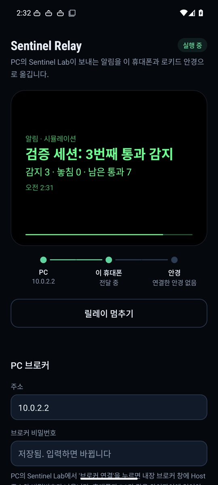
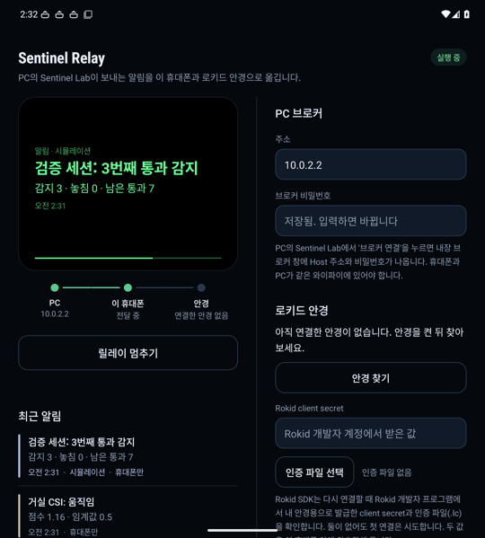

# Wavrel Relay (안드로이드)

[English](README.md)

Wavrel Relay는 PC의 Wavrel이 보내는 알림을 안드로이드 휴대폰으로 받아 로키드 안경에
띄웁니다. 링크에서 움직임이 시작되거나, 기기가 방에 들어오거나, 검증 세션에서 한 번 지나갈 때마다
결과를 PC 앞으로 돌아가지 않고 렌즈에서 읽을 수 있습니다.

```
 PC: Wavrel ── 와이파이, MQTT ──▶ 휴대폰: Wavrel Relay ── 블루투스, Rokid CXR-M ──▶ 로키드 안경
   lab/out/notify                          휴대폰 알림                                검은 바탕에 초록 글자
```

휴대폰은 듣기만 합니다. 브로커에 아무것도 발행하지 않고, 데스크톱 앱은 자기 자신 말고는 알림 토픽
발행을 거절하므로(T-HUB-010) 릴레이로 알림을 꾸밀 수 없습니다.

| 휴대폰 | 펼친 화면 (갤럭시 폴드 안쪽 화면 비율) |
|---|---|
|  |  |

CI 에뮬레이터가 데스크톱 앱의 브로커에 붙어 찍은 화면입니다.

## 상태

| | |
|---|---|
| 빌드와 단위 시험 | 푸시할 때마다 `relay` 워크플로에서 (T-REL-001 ~ T-REL-009) |
| 데스크톱 앱 브로커와 주고받기 | 푸시할 때마다 안드로이드 15 에뮬레이터에서: 틀린 비밀번호, 연결, 화면과 휴대폰 알림에 알림 도착, 시뮬레이션 표시, 한국어, 펼친 화면 |
| 실제 휴대폰과 PC 앱으로 실행 | 아직 안 함 (OPERATOR_REQUIRED) |
| 로키드 안경에서 실제 실행 | 아직 안 함 (OPERATOR_REQUIRED). Rokid CXR-M SDK 문서는 1세대 Rokid Glasses 기준이라 Rokid Glasses 2에서 동작하는지는 확인되지 않았습니다 |

## 설치

1. [relay 워크플로](https://github.com/pengveloper/wavrel/actions/workflows/relay.yml)의
   가장 최근 성공한 실행에서 `wavrel-relay-debug-apk`를 내려받습니다. GitHub에 로그인해야 받을 수
   있습니다.
2. 압축을 풀어 APK를 휴대폰으로 옮기고 엽니다. 처음 한 번 그 앱(내 파일, 크롬 등)에서 설치를
   허용할지 묻습니다.
3. 디버그 빌드는 빌드마다 다른 키로 서명됩니다. 새 버전을 깔려면 이전 것을 먼저 지워야 하고, 이때
   설정도 지워집니다.

## PC와 연결

1. PC에서 Wavrel을 켜고 **브로커 연결**을 누릅니다. **내장 브로커** 창에 Host 주소, 포트,
   비밀번호가 나옵니다.
2. 휴대폰과 PC가 같은 와이파이에 있어야 합니다. 브로커를 처음 켤 때 Windows 방화벽 창이 떴다면 개인
   네트워크가 허용되어 있어야 합니다.
3. 릴레이에 주소와 비밀번호를 넣고 **릴레이 시작**을 누릅니다.
4. PC의 **자동화** 화면에서 **시험 알림 보내기**를 누르면 릴레이 화면과 휴대폰 알림에 나타납니다.

비밀번호가 한 번 틀리면 릴레이는 다시 시도하지 않고 멈춥니다. 브로커가 다섯 번 틀린 주소를 1분
동안 막기 때문입니다.

## 안경 연결

1. 안경을 켜서 가까이 두고 **안경 찾기**를 눌러 목록에서 고릅니다.
2. Rokid SDK는 다시 연결할 때 Rokid 개발자 프로그램에서 내 안경용으로 발급한 client secret과 인증
   파일(`.lc`)을 확인합니다. secret을 넣고 파일을 고릅니다. 둘이 없어도 Rokid SDK가 확인하지 않는
   첫 연결은 시도합니다.
   Rokid 개발자 콘솔이 앱의 패키지 이름을 물으면 `com.wavrel.relay`를 넣습니다.
3. **안경에 시험 화면 띄우기**를 누릅니다.

안경에는 한 번에 한 화면만 띄웁니다. 주의인지 알림인지와 값의 출처를 적은 줄, 제목, 본문, 시각을
검은 바탕(렌즈에서는 투명)에 초록 글자로 보여 주고, 알림의 `ttl`이 지나면 닫습니다. 새 알림이 오면
바꿔 씁니다.

## 기기에서 확인할 것

아래는 누군가 실제로 해 보고 [EVIDENCE-P1](../evidence/EVIDENCE-P1.md)에 결과를 적을 때까지 열린
항목입니다.

1. 휴대폰과 PC: 시험 알림이 1초 안에 오고 휴대폰 알림이 뜨는지
2. 틀린 비밀번호: 릴레이가 그렇다고 알려 주고 스스로 차단되지 않는지
3. 안경 첫 연결: 인증 파일이 있을 때와 없을 때
4. 알림 화면이 뜨고, 한글이 제대로 보이고, 가장자리에서 잘리지 않는지
5. 첫 알림의 `ttl` 안에 두 번째 알림이 오면 깜빡임 없이 글자만 바뀌는지
6. 휴대폰을 30분 잠가 둔 뒤에도 알림이 안경까지 가는지
7. 릴레이가 안경을 잡고 있는 동안 Rokid 공식 앱을 꺼 둬야 하는지

## 개인정보와 보안

- 모든 통신은 로컬 네트워크 안에서만 합니다. 공용 주소는 시도하기 전에 거절하며, 브로커의 규칙과
  같습니다. 호스트 이름은 먼저 풀어 보고, 로컬 주소로 풀릴 때만 그 주소로 비밀번호를 보냅니다.
- 브로커 비밀번호, Rokid secret과 인증 파일, 안경 연결 정보는 Android Keystore 안의 AES-GCM 키로
  봉인합니다. 이 앱은 백업을 끕니다.
- 릴레이는 기록을 남기지 않습니다. 안경의 블루투스 주소는 화면에 보이지 않고, 안경 목록에는 끝
  두 글자만 보입니다.
- 시뮬레이션이나 재생한 값은 알림 형식이 정한 대로 휴대폰과 렌즈에 표시합니다.

## 직접 빌드

JDK 17, Gradle 8.14, Android SDK(플랫폼 35)가 필요합니다.

```sh
cd relay/android
gradle testDebugUnitTest assembleDebug
```

Rokid SDK 버전은 `gradle.properties`의 `rokidCxrVersion`입니다. 워크플로 기록에 Rokid 저장소가 내놓은
버전 목록이 찍힙니다. Rokid가 버전마다 `connectBluetooth`의 매개변수를 바꿔 왔기 때문에, 릴레이는
쓰는 SDK에 있는 형태에 맞춰 값을 채웁니다
([ConnectArgs.kt](android/app/src/main/java/com/wavrel/relay/ConnectArgs.kt)).

## 외부 코드

| 구성 요소 | 라이선스 |
|---|---|
| Eclipse Paho MQTT client 1.2.5 | EPL-2.0 또는 EDL-1.0 |
| Gson, Retrofit, OkHttp, Okio | Apache-2.0 |
| Rokid CXR-M SDK | Rokid의 조건. 빌드할 때 Rokid Maven 저장소에서 내려받으며 이 저장소에는 넣지 않습니다 |
