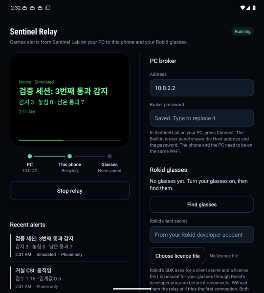
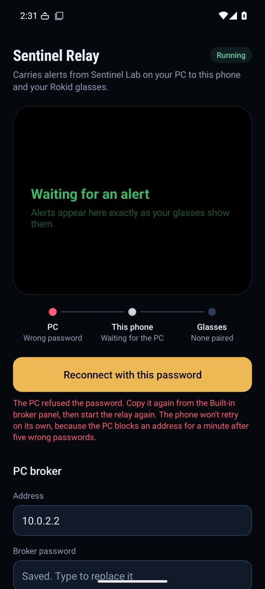

# Wavrel Relay (Android)

[한국어](README.ko.md)

Wavrel Relay carries Wavrel's alerts from your PC to an Android phone and on to Rokid
glasses. When something happens, you read it on the lens without going back to the PC: motion
starting on a link, a device entering a room, or the outcome of each pass in a validation walk.

```
 PC: Wavrel ── Wi-Fi, MQTT ──▶ Phone: Wavrel Relay ── Bluetooth, Rokid CXR-M ──▶ Rokid glasses
   lab/out/notify                        phone notification                         green text on black
```

The phone only listens. It never publishes to the broker, and the desktop app refuses alerts from
any client but itself (T-HUB-010), so the relay cannot be used to fake an alert.

| Unfolded (Galaxy Fold inner screen proportions) | After a wrong password |
|---|---|
|  |  |

Screenshots from the CI emulator run against the desktop app's broker.

## Status

| | |
|---|---|
| Built and unit tested | Every push, in the `relay` workflow (T-REL-001 to T-REL-009) |
| Against the desktop app's broker | Every push, in an Android 15 emulator: wrong password, connect, alert on screen and as a notification, simulated values labelled, Korean, unfolded layout |
| On a real phone with the PC app | Not run yet (OPERATOR_REQUIRED) |
| On Rokid glasses | Not run yet (OPERATOR_REQUIRED). Rokid's CXR-M SDK documents the first generation of Rokid Glasses. Whether it drives Rokid Glasses 2 is not confirmed |

## Install

1. On the phone, open
   [Wavrel-Relay.apk](https://github.com/pengveloper/wavrel/releases/latest/download/Wavrel-Relay.apk)
   from the latest release (also linked on [wavrel.com](https://wavrel.com/en/#get)). No GitHub account needed.
2. Open the downloaded file. Android asks once to allow installs from that app (Chrome, Files and so on).
3. Release builds are signed with the project's own key, so a newer release installs over the old
   one and keeps its settings. A test build from the relay workflow (`wavrel-relay-debug-apk`) uses a
   different key: uninstall it before installing a release, and the other way round.

## Connect to the PC

1. On the PC, start Wavrel and press **Connect**. The **Built-in broker** panel shows the
   Host address, the port and the password.
2. The phone and the PC need to be on the same Wi-Fi. If Windows asked about the firewall when
   the broker first started, private networks must be allowed.
3. In the relay, enter the address and the password and press **Start relay**.
4. On the PC, press **Send a test alert** in **Rules**. It appears in the relay and as a phone
   notification.

The relay stops after one wrong password instead of retrying, because the broker blocks an
address for a minute after five failed logins.

## Connect the glasses

1. Turn the glasses on and keep them close. Press **Find glasses** and pick them from the list.
2. Rokid's SDK checks a client secret and a licence file (`.lc`) issued for your glasses through
   Rokid's developer program before it reconnects. Enter the secret and choose the file. Without
   them the relay still tries the first connection, which Rokid's SDK does not check.
   When Rokid's developer console asks for the app's package name, it is `com.wavrel.relay`.
3. Press **Show a test on the glasses**.

The relay shows one screen at a time: a line saying whether it is an alert and where the values
came from, the title, the body and the time, in green on black (black is clear on the lens). The
screen closes after the alert's `ttl`. A newer alert replaces it.

## Ask the PC out loud

With the PC connected, "Ask the PC out loud" opens the phone's own voice input. What you say goes
to the PC as one question on `lab/in/ask`; in the Wavrel desktop app's Models view, turn on
"Answer questions from phone and glasses" and pick a model. The model answers in under 80
characters, and the answer comes back as an alert: on the phone and on the glasses, labelled
"PC model". The relay records nothing itself; the phone's voice input does the listening.
Format: [docs/NOTIFY.md](../docs/NOTIFY.md).

## What to check on the device

These are open until someone runs them and records the result in
[EVIDENCE-P1](../evidence/EVIDENCE-P1.md):

1. Phone and PC: the test alert arrives within a second and the phone notification appears.
2. Wrong password: the relay says so and does not lock itself out.
3. Glasses, first pairing, with and without the licence file.
4. The alert screen appears, Korean text renders, and nothing is cut at the edges.
5. A second alert inside the first one's `ttl` replaces the text (update) rather than flashing.
6. With the phone locked for 30 minutes, alerts still reach the glasses.
7. Rokid's own phone app: does it need to be closed while the relay holds the glasses?
8. Ask the PC out loud with a model running in the desktop app: the answer reaches the phone and the glasses, labelled "PC model".

## Privacy and security

- Everything stays on the local network. The relay refuses public addresses before it tries
  them, matching the broker's own rule. A host name is resolved first and the password goes
  only to a local address it resolves to.
- The broker password, the Rokid secret and licence, and the glasses' link details are sealed
  with an AES-GCM key held in the Android Keystore. Backups are off for this app.
- The relay writes no logs. The glasses' Bluetooth address is never shown; the list of glasses
  shows the last two characters only.
- Simulated or replayed values are labelled on the phone and on the lens, as the alert format
  requires.

## Build from source

JDK 17, Gradle 8.14 and the Android SDK (platform 35):

```sh
cd relay/android
gradle testDebugUnitTest assembleDebug
```

The Rokid SDK version is `rokidCxrVersion` in `gradle.properties`. The workflow log lists the
versions Rokid's repository offers. Rokid has changed the parameters of `connectBluetooth`
between releases, so the relay fills whichever form the SDK in use has
([ConnectArgs.kt](android/app/src/main/java/com/wavrel/relay/ConnectArgs.kt)).

## Third-party code

| Component | Licence |
|---|---|
| Eclipse Paho MQTT client 1.2.5 | EPL-2.0 or EDL-1.0 |
| Gson, Retrofit, OkHttp, Okio | Apache-2.0 |
| Rokid CXR-M SDK | Rokid's terms. Downloaded from Rokid's Maven repository at build time and not stored in this repository |
